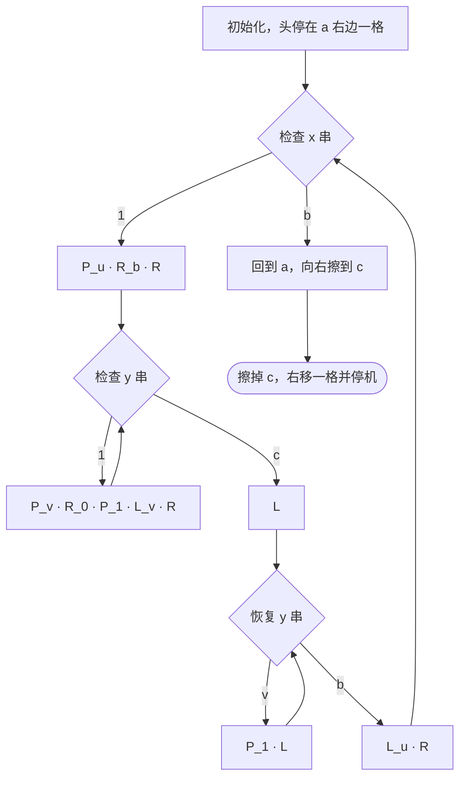

# §7.3 图灵机习题解答

[返回习题目录](../README.md)

依据郝兆宽、杨睿之、杨跃《数理逻辑：证明及其限度（第二版）》§7.3 整理。纸带、指令与输入输出约定见印刷页 133–135，习题见印刷页 138–139。

## 记号约定

- 格局 $u q a v$ 记录纸带内容、状态 $q$ 和读写头的位置。头下的符号是紧挨在 $q$ 右边的 $a$。当前状态和头下符号共同决定下一条指令。
- 四元组 $q\,a\,a'\,r$ 写入 $a'$ 并进入状态 $r$，头留在原格。四元组 $q\,a\,D\,r$ 沿 $D\in\{L,R\}$ 移动一格并进入 $r$，纸带内容照旧。
- 输入第 $i$ 块有 $x_i+1$ 个连续的 $1$，块之间以空白符号 $0$ 分隔。输入 $0$ 也占一块。输出 $y$ 恰好有 $y$ 个连续的 $1$，头停在这串的首格。输出 $0$ 时纸带全空。
- $P_z$ 在当前格写入 $z$。$R_z$ 和 $L_z$ 分别向严格右侧和严格左侧寻找第一个 $z$。$R$ 和 $L$ 分别移动一格。并排的子程序从左到右执行。

| 题号 | 内容 |
| --- | --- |
| [7.3.1](#exercise-731) | 编写零函数、后继函数和投射函数的程序 |
| [7.3.2](#exercise-732) | 用四元组判定 $x=y$ |
| [7.3.3](#exercise-733) | 用两个字符模拟三个字符 |
| [7.3.4](#exercise-734) | 证明四元组和五元组的图灵机等价 |
| [7.3.5](#exercise-735) | 用有向转移图计算 $xy$ |

<a id="exercise-731"></a>

## 7.3.1　零函数、后继函数和投射函数

为 $Z(x)=0$、$S(x)=x+1$ 和 $\pi_i^n(x_1,\ldots,x_n)=x_i$ 分别编写图灵机程序。

### 零函数

从首格出发，擦掉一个 $1$ 就右移一格，走到原串右侧的空白时停机。三条指令如下。

```text
q_s 1 0 q_1
q_1 0 R q_s
q_s 0 0 q_h
```

在 $q_1$ 读到的 $0$ 是刚擦出来的，下一步要右移。在 $q_s$ 读到的 $0$ 是右移后遇到的，表示原串已经擦完。相同的纸带符号在不同状态下可以触发不同动作。

### 后继函数

输入 $x$ 的纸带已经有 $x+1$ 个 $1$，正好是输出 $S(x)$ 需要的长度，因此在首格原样写回 $1$ 后停机。

```text
q_s 1 1 q_h
```

### 投射函数

把零函数的程序记作子程序 $E$。每次从一个输入块的第一格调用 $E$，它擦完该块并停在块后的 $0$。投射函数的程序为

$$
(ER)^{i-1}\;P_aR_0\;(RE)^{n-i}\;L_aP_0R.
$$

1. 执行 $(ER)^{i-1}$，擦掉前 $i-1$ 块，停在第 $i$ 块首格。
2. 执行 $P_aR_0$，将第 $i$ 块的第一个 $1$ 标成 $a$，然后移到该块右边的 $0$。
3. 执行 $(RE)^{n-i}$，从分隔格进入下一块并擦除，直到后面的块全部擦完。
4. 执行 $L_aP_0R$，找到并擦掉 $a$，再右移一格停机。其右侧原有的 $x_i$ 个 $1$ 就是输出。

例如 $\pi_2^3(2,1,0)$ 的输入是 `111 0 11 0 1`。保留中间块，擦掉它用作标记的第一个 $1$，输出就只剩一个 $1$。当 $x_i=0$ 时，$a$ 仍能标出返回位置，擦掉它以后纸带全空。

<a id="exercise-732"></a>

## 7.3.2　判定两个数是否相等

编写具体四元组，使机器在 $x=y$ 时输出 $1$，否则输出 $0$。

先把输入的分隔符 $0$ 改成 $a$。每轮擦掉左边最外侧的一个 $1$，然后擦掉右边最外侧的一个 $1$。从外端擦可以让左右剩下的串始终紧挨着 $a$。例如输入 $(1,1)$ 时，标记分隔符后的纸带依次为 `11a11`、`1a1`、`a`。

| 操作 | 四元组 |
| --- | --- |
| 找到分隔符并写成 $a$ | `q_s 1 R q_s`、`q_s 0 a q_1` |
| 向左走到空白，再右移一格 | `q_1 1 L q_1`、`q_1 a L q_1`、`q_1 0 R q_2` |
| 左边有 $1$，擦掉它并右移 | `q_2 1 0 q_3`、`q_3 0 R q_4` |
| 走到右端的空白，再左移检查 | `q_4 1 R q_4`、`q_4 a R q_4`、`q_4 0 L q_5` |
| 右边也有 $1$，擦掉它并返回 | `q_5 1 0 q_6`、`q_6 0 L q_1` |
| 左边已经空了，越过 $a$ 检查右边 | `q_2 a R q_7` |
| 右边也空了，把 $a$ 改成结果 $1$ | `q_7 0 L q_8`、`q_8 a 1 q_h` |
| $q_5$ 读到 $a$，擦掉分隔符并准备向左清理 | `q_5 a 0 p_L` |
| $q_7$ 读到 $1$，返回并擦掉分隔符，准备向右清理 | `q_7 1 L q_9`、`q_9 a 0 p_R` |
| 向左清理到空白，输出 $0$ | `p_L 0 L e_L`、`e_L 1 0 p_L`、`e_L 0 0 q_h` |
| 向右清理到空白，输出 $0$ | `p_R 0 R e_R`、`e_R 1 0 p_R`、`e_R 0 0 q_h` |

刚写完分隔符时，头仍然对着唯一的 $a$。因此进入 $q_1$ 后要用 `q_1 a L q_1` 跨过它。以后从右端返回时，也靠这条指令经过同一个 $a$。

每次成功返回 $q_2$，左右就各少了一个 $1$。如果 $q_2$ 读到 $a$，左边的 $1$ 已经全部配过。此时 $q_7$ 读到 $0$ 才说明两边同时配完。如果 $q_5$ 读到 $a$，则这一轮刚从左边擦去的 $1$ 找不到配对项，答案是 $0$。有限个字符最终都会配完或触发清理分支。

<a id="exercise-733"></a>

## 7.3.3　用二元字母表模拟三元字母表

设字母表为 $\{0,1,a\}$ 的图灵机 $M_1$ 计算一元函数 $f$。构造只使用 $\{0,1\}$ 的 $M_2$，使它计算同一个函数。

### 编码与模拟

约定 $0\mapsto 00$、$1\mapsto 11$、$a\mapsto 10$。纸带上每两格表示 $M_1$ 的一格。空白编码为 `00`，所以无限空白区直接符合编码约定。

每次模拟一步前，$M_2$ 的状态记录 $M_1$ 的当前状态，头对准所扫描的编码块的第一格。$M_2$ 依次读出两位，把它们记在有限状态中，并按 $M_1$ 对应的指令操作。

- 若 $M_1$ 改写一格，$M_2$ 改写对应的两位，然后把头移回这组的第一格。
- 若 $M_1$ 左移或右移一格，$M_2$ 到达相邻编码块的第一格。从当前块首算起，移动距离是两格。

每一步模拟结束时，$M_2$ 恢复上述对齐条件并记录更新后的状态。状态、两位编码和指令选择均只有有限种情况，因此可以用有限条指令实现逐步模拟。

### 首尾的格式转换

$M_2$ 接收的标准输入有 $x+1$ 个 $1$，先将这一串加倍，再从新串首格开始模拟。加倍只需二元字母表。将输入左边紧邻的一格空白用作分隔。在每轮中，从右串的最右端擦一个 $1$，回到分隔格，再在左串的最左端添两个 $1$。两串在非空时始终紧挨着分隔格，借此可以通过扫描找到边界。例如，竖线表示分隔格时，有

$$
\varepsilon\mid 11\;\longrightarrow\;11\mid 1\;\longrightarrow\;1111\mid\varepsilon.
$$

若 $M_1$ 停机并输出 $y$，模拟纸带上有 $2y$ 个连续的 $1$。用同样的分隔办法，每轮从右串末端擦两个 $1$，向左串添一个 $1$，最后停在输出串首格。$y=0$ 时空白纸带直接给出输出。若 $M_1$ 发散，$M_2$ 会一直模拟它的指令。因此两台机器对每个标准输入有相同的输出和停机行为。

<a id="exercise-734"></a>

## 7.3.4　四元组与五元组的等价性

五元组 $q\,a\,a'\,r\,D$ 先写入 $a'$，再沿 $D\in\{L,R\}$ 移动一格，最后进入 $r$。为每条需要拆分的原指令选一个专用的新状态 $p$。

| 原指令 | 替换方式 |
| --- | --- |
| 五元组 $q\,a\,a'\,r\,D$ | 先执行四元组 $q\,a\,a'\,p$，再执行 $p\,a'\,D\,r$ |
| 移动型四元组 $q\,a\,D\,r$ | 执行五元组 $q\,a\,a\,r\,D$，原样写回 $a$ 并移动 |
| 写入型四元组 $q\,a\,a'\,r$ | 先执行五元组 $q\,a\,a'\,p\,R$。对每个 $b\in A$，加入 $p\,b\,b\,r\,L$ |

第一种替换中的第二步仍在原格读到刚写入的 $a'$。第三种替换中，第一步写完以后头已经在右边。第二步需要覆盖右边可能读到的所有 $b$，并原样写回 $b$，然后左移回原位置。例如，执行 $q\,1\,0\,r$ 时，两步模拟可以产生下面的格局序列。

$$
1\,q\,11\;\longrightarrow\;10\,p\,1\;\longrightarrow\;1\,r\,01.
$$

每次替换执行完毕，纸带、读写头位置和状态都与原指令的结果一致。每条原指令对应一两步，专用状态不会与原来的指令冲突，所以整次计算的停机情况和输出都保留。

<a id="exercise-735"></a>

## 7.3.5　用有向转移图计算乘法

为 $f(x,y)=xy$ 编写有向转移图。每处理一个 $x$ 串里的 $1$，就把 $y$ 串复制一遍到输出尾部。

### 初始化与复制

用 $P_aR_0P_bR_0LP_cL_aR$ 把标准输入 $1^{x+1}0\,1^{y+1}$ 布置为 $a\,1^x\,b\,1^y\,c$，头停在 $a$ 的右边一格。具体而言，将最左边的 $1$、中间的 $0$ 和最右边的 $1$ 分别改成 $a,b,c$。输出从 $c$ 的右边开始。

- 外层循环将正在处理的 $x$ 串字符标成 $u$，再过 $b$ 去访问 $y$ 串。
- 内层循环每次把一个 $y$ 串字符标成 $v$，到最右边的空白追加一个 $1$，然后向左找到最近的 $v$，右移到下一个待复制的格子。
- 内层读到 $c$ 时，向左逐个把 $v$ 恢复成 $1$。回到 $b$ 后，向左找到最近的 $u$，右移到下一个待处理的 $x$ 串字符。

### 有向转移图

箭头上的字符表示当前格读到的符号。



清理时，先从 $b$ 执行 $L_a$，再对当前读到的 $a,u,b,1$ 执行 $P_0R$ 并继续检查。读到 $c$ 时也执行 $P_0R$，随后停机。这样 $c$ 右边的输出串保留，头在它的首格。

完成 $k$ 轮且恢复 $y$ 串后，工作区域的内容为

$$
a\,u^k1^{x-k}\,b\,1^y\,c\,1^{ky}.
$$

当头在外层读到 $b$ 时，恰好完成 $x$ 轮，因此输出区有 $xy$ 个连续的 $1$。$x=0$ 时直接进入清理，$y=0$ 时每轮都会立刻读到 $c$，输出区始终为空。
